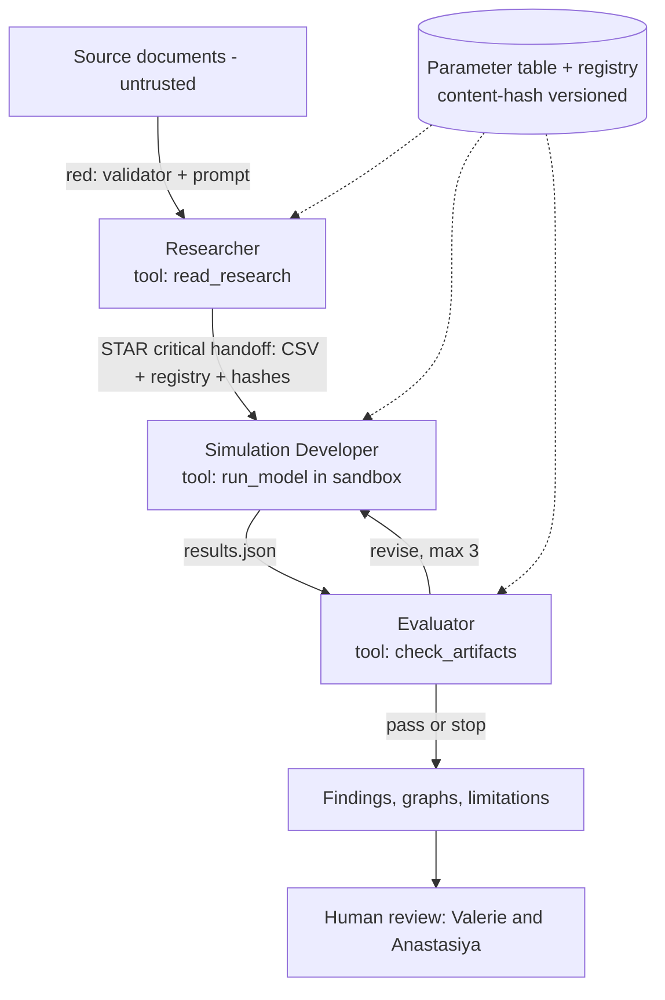

# Architecture notes: enforced by, shared state, critical handoff (DRAFT)

Drafted 2026-10-22 by Valerie with Claude Code.  These notes go with the architecture diagram (`lynxboard.png`), which needs a second version.  Draw version 2 on paper together first (LaNice's rule), then commit the picture and this file in the same pull request as the code it describes.

## What the diagram v2 must show

- Red arrows for text we do not trust:  (1) source documents into the Researcher; (2) any agent output into the harness; (3) text inside the `evidence_or_assumption` column read by the Developer or the Evaluator.  Beside each arrow, say what catches it.
- A star on the one critical handoff:  the parameter table and source registry (with content hashes) from the Researcher to the Simulation Developer.  If it is dropped or stale, every later result is wrong.
- A box for the single shared state:  "Parameter table and source registry, versioned by content hash; the Researcher writes, the Developer and Evaluator read."
- Under each agent, its one tool:  `read_research`, `run_model` (sandboxed), `check_artifacts`.
- A human box after the output:  Valerie and Anastasiya review findings before anyone interprets them.
- A legend with two tags:  CODE (the harness enforces it) and PROMPT (the model is asked).
- At each handoff, the failure response:  hand back, escalate to a person, or fail loudly (stop and report).

## Enforced by

| Rule | Enforced by |
|---|---|
| Handoff files match the schema | CODE (validator) |
| Content hashes match across handoffs | CODE (`check_handoff_hashes`, pull request 9; it compares the hash fields only) |
| Run ID, seed, and revision round match across handoffs | CODE, planned (not built; `check_handoff_hashes` does not check them) |
| Parameter files unchanged since the input | CODE (`check_files_current`, pull request 9) |
| Maximum 3 revision rounds, then stop and report | CODE (harness) |
| Generated code runs under the execution rules | CODE (`docs/execution-sandbox.md`) |
| Source text is evidence, never instructions | PROMPT plus CODE (unknown source keys rejected) |
| Do not invent citations, values, or results | PROMPT, checked by the Evaluator |
| Historical validation stays "not assessed" until the test runs | CODE (schema constant) |

## Draft diagram source

## Open decisions

- Who writes the shared state (this draft says the Researcher only).
- Whether the harness or the Researcher computes the content hashes.
